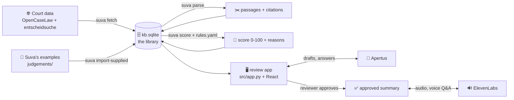
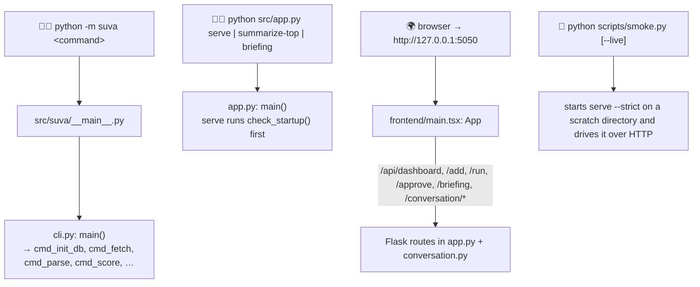
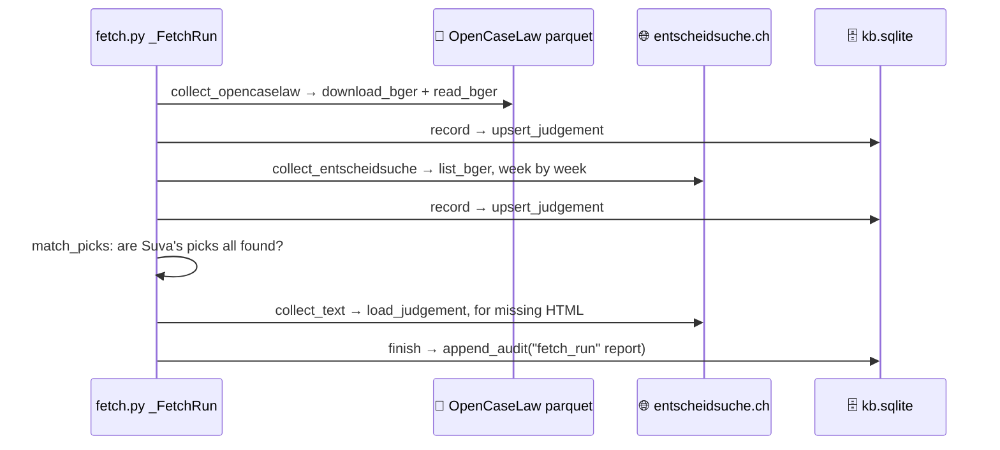
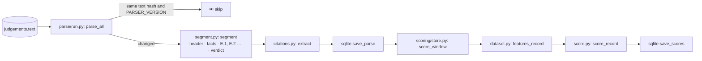
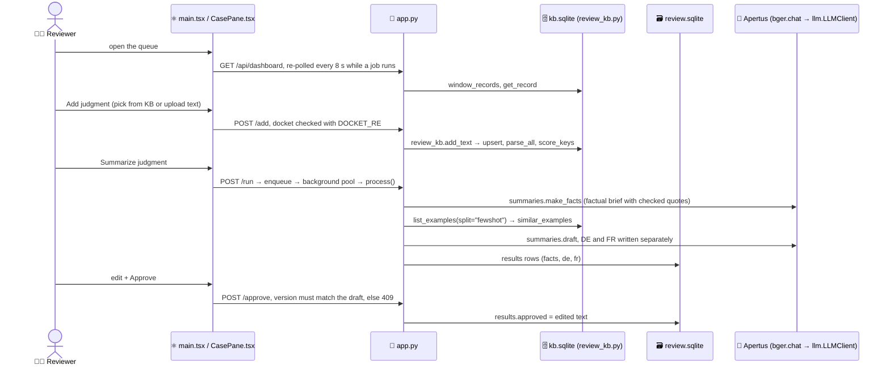
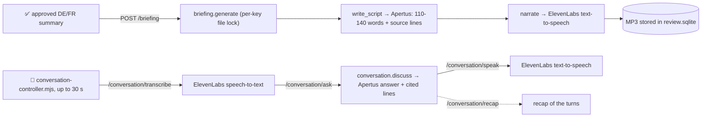
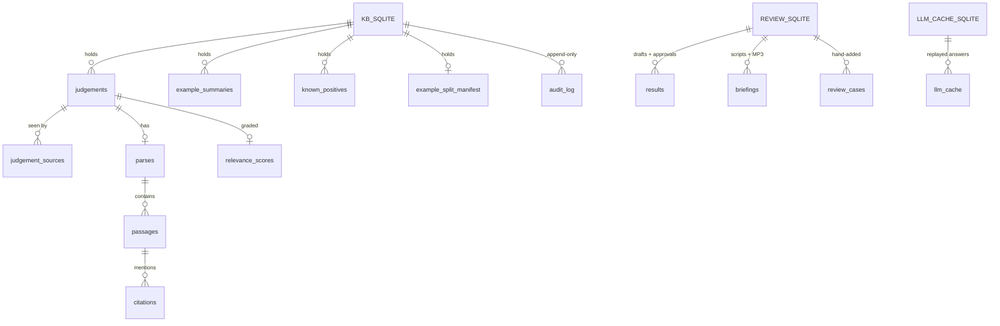

# How the Suva judgement review project works

A 5-minute tour of `hackapertus-suva-niki`. The diagrams are Mermaid and render on GitHub, in VS Code preview and in
Obsidian. This is the single architecture overview. The repo files cover narrower topics:

| Document | Covers |
|---|---|
| `AGENTS.md` | rules for working on the code: code map, invariants, commands |
| `README.md` | how to run it |
| `technical_report.md` | the write-up for the submission |
| `src/suva/scoring/README.md` | scoring in depth |
| `SMOKE_TEST.md` | how to check a running install |

---

## 0. The whole thing in one picture

The project is a **librarian for court rulings**:

1. 📥 It **collects** new rulings from the Swiss Federal Supreme Court.
2. ✂️ It **cuts** each ruling into labelled chapters and notes every law it cites.
3. 🎯 It **grades** each ruling from 0 to 100 for how much it matters to Suva, and says why. Plain rules do this, no AI.
4. 🧑‍⚖️ A **local website** lists the best ones first. The Apertus AI drafts German and French summaries, and a human
   approves them.
5. 🔊 Approved summaries can be **read aloud**, and you can **ask the ruling questions by voice** (ElevenLabs).



---

## 1. Folder structure

```
hackapertus-suva-niki/
├── judgements/        📁 INPUT from Suva: example summaries (Export_*.html) + spreadsheet of picks (xlsx)
├── rules/rules.yaml   📏 the scoring rulebook experts edit (fit-weights writes rules.fitted.yaml next to it)
├── src/
│   ├── suva/          🏭 the pipeline, run as `python -m suva …`
│   │   ├── cli.py        🚪 every command starts here
│   │   ├── config.py     ⚙️ settings from .env / environment, plus logging setup (LOG_LEVEL)
│   │   ├── ingest/       📥 reads Suva's examples and picks; freezes the few-shot/eval split
│   │   ├── sources/      🌐 one adapter per court-data website; quality.py rejects error pages
│   │   ├── http.py       🐢 polite HTTP client: 2 s between requests, retries, stops on 403
│   │   ├── fetch.py      🚚 runs the collecting; windows.py picks the date range; coverage.py reports it
│   │   ├── parse/        ✂️ chapters (segment.py) and law citations (citations.py)
│   │   ├── scoring/      🎯 rules → score, plus tools to test and tune the rules
│   │   ├── storage/      🗄️ ALL SQL for the knowledge base (sqlite.py) and its schema (migrations.py)
│   │   └── llm.py        🤖 the one Apertus client, with a replay cache and an audit trail
│   ├── app.py         🖥️ the review website (Flask) and its batch commands
│   ├── review_kb.py   🔌 lets the website read the knowledge base
│   ├── summaries.py   📝 factual brief + DE/FR drafts
│   ├── bger.py        🧰 shared app helpers: .env reader, Apertus config check, chat call
│   ├── briefing.py    🔊 audio briefing (text-to-speech)
│   ├── conversation.py 🎙️ voice Q&A about one ruling
│   └── frontend/      ⚛️ React/TypeScript UI, built by Vite into dist/
├── scripts/smoke.py   🧪 end-to-end smoke test that starts the real server (see SMOKE_TEST.md)
├── tests/             🧪 offline tests: pytest for Python, node --test for the voice UI
└── data/              💾 generated, never committed: databases, downloads, scoring outputs, lock files
```

---

## 2. Entry points (the four front doors 🚪)



- `serve --strict` refuses to start, and exits with code 2, if the LLM settings, the frontend build or the knowledge
  base is missing.
- `serve` without the flag logs the same problems and starts anyway.

---

## 3. The five most important flows

### Flow 1: load Suva's examples (`import-supplied`, then `split-examples`)

1. `ingest/exports.py: parse_export_dir` reads each HTML summary: docket, date, language, text.
2. `ingest/picks.py: read_picks` reads the spreadsheet of rulings Suva picked.
3. `ingest/importer.py: import_supplied` matches each pick to a `docket@YYYY-MM-DD` key. A pick that can't be matched
   is marked `unresolved:`.
4. `storage/sqlite.py: replace_supplied` swaps in the whole set in **one** transaction.
5. `ingest/split.py: apply_split` → `compute_split` → `sqlite.freeze_examples` puts each example in *few-shot* (the AI
   may see it as a style example) or *eval* (kept hidden), and freezes that choice in a manifest.

### Flow 2: collect rulings (`fetch --window dev|challenge`)

The window comes from `windows.py`:
- **dev:** decisions from 2025-10-01 to 2026-03-31.
- **challenge:** rulings *published* in the 3 months before "today".



- **Merging:** `upsert_judgement` merges what each source says about the same `docket@date` key.
- **Failures:** a failing source is marked `failed` or `blocked` in the report, and the other source still completes.
- **The receipt:** the `fetch_run` audit entry is what `suva coverage` reads later.

### Flow 3: parse and score (`parse`, `score`)



- **Passages:** each passage keeps its exact original text and its start and end positions in the stored ruling.
- **Points:** a score adds up the points of the rules that fire. With the real `rules.yaml`, a ruling about accident
  insurance (+51), decided by chamber 8C (+32), with Suva as a party (+6) and three UVG articles (+18) gets
  −95 + 107 = 12 points.
- **The 0–100 score:** a sigmoid turns those 12 points into about 77, which is the 🟢 **high** band. High starts at 50,
  low is below 5, and in between is 🟡 check.
- **Ties:** scores above about 368 points all round to 100.0, so those are ordered by points.
- **Staleness:** each stored score keeps fingerprints of the rules, the parse and the text. If one changes, the app
  shows the score as **Stale** until `suva score` runs again.
- **Tuning tools** (see `scoring/README.md`):
  - `dataset`: labels come from Suva's picks; decisions from 2026-03-01 onward go to the test split.
  - `analyze`, `evaluate`, `fit-weights`, and `judge` (Apertus as a second opinion).

### Flow 4: review → draft → approve (the website)



- **Background jobs:** `process()` holds a per-draft file lock (`data/summary-locks/`). The web server and
  `summarize-top` therefore never pay for the same Apertus call twice.
- **Failures:** a failed draft stores a short error. The UI shows it, and the next click retries.

### Flow 5: audio briefing and voice questions



- **Audio cache:** the audio is cached per approved text, language, voice and model. Editing the approval makes a new
  briefing.
- **Crashed jobs:** a briefing job that crashes unexpectedly stores "Briefing failed unexpectedly. Try again." instead
  of vanishing silently.
- **Conversations:** the history lives only in the browser tab (6 turns). The server stores nothing, and logs never
  contain the question.

---

## 4. Where state, database calls and external APIs live

### Three SQLite databases



| Database | Who writes SQL | Notes |
|---|---|---|
| `data/kb.sqlite`, the library | only `src/suva/storage/sqlite.py` | Schema in `migrations.py` (001–007, append-only). Writes go through `_write()` = `BEGIN IMMEDIATE`. |
| `data/review.sqlite`, the website's notebook | raw SQL inside `src/app.py` (`connect()`) and `briefing.generate` | Schema created on every connect. |
| `data/llm_cache.sqlite` | `src/suva/llm.py: LLMCache` | Pipeline calls only. The review app turns the cache off. |

### Files on disk

- `data/raw/opencaselaw/bger.parquet`: about 925 MB.
- `data/raw/entscheidsuche/<id>.html`: downloaded rulings, validated before being cached.
- `data/scoring/*`: outputs of the tuning tools.
- `data/summary-locks/`, `data/briefing-locks/`: lock files.
- `src/frontend/dist/`: the built UI.

### Outside services

| Service | For | Code | Settings |
|---|---|---|---|
| 🤗 Hugging Face (OpenCaseLaw) | bulk ruling text | `sources/opencaselaw.py: download_bger` | — |
| 🌐 entscheidsuche.ch | search + ruling HTML | `sources/entscheidsuche.py: list_bger, load_judgement` via `http.py: PoliteClient` | — |
| 🤖 Apertus (OpenAI-compatible) | judge, briefs, drafts, scripts, answers | `suva/llm.py: LLMClient.chat`; the app goes through `bger.chat` | `LLM_NAME`, `LLM_BASE_URL`, `LLM_API_KEY` (via `config.py`) |
| 🔊 ElevenLabs text-to-speech | briefings + spoken answers | `briefing.py: narrate` | `ELEVENLABS_API_KEY`, `ELEVENLABS_VOICE_ID_DE/FR` (via `bger.local_config`) |
| 🎤 ElevenLabs speech-to-text | voice questions | `conversation.py: transcribe` | same key |

### Runtime state and logs

- **Browser:** React (`main.tsx`) keeps the view in the URL (`case`, `lang`, `view`, `q`, `status`, `sort`,
  `page`). The voice chat (`conversation-controller.mjs`) is plain JavaScript with its own in-memory turns.
- **Server:** the summary and briefing jobs run in one background thread (`pool`, `max_workers=1`). The `pending`
  set stops duplicate jobs.
- **Logs:** go to stderr as `event key=value` lines, at the level set by `LOG_LEVEL`; `config.configure_logging` sets
  this up in both entry points. Log lines carry IDs, stages, HTTP codes and error class names, never keys, prompts or
  texts. The browser logs failures with `console.warn`.

---

## 5. ❓ Questions for you: unclear, duplicated or tangled areas

*Observations only. Nothing here was changed.*

1. **`bger.py` naming.** It is really "shared app helpers". Is "bger" meant to mean that?
2. **No audit or cache for app AI calls.** `bger.chat` passes `repo=None` and turns the cache off, so review-app
   Apertus calls never reach `audit_log`. The new `llm_call_failed` log line is the only trace of them. Is that
   intended?
3. **Two `.env` readers and two root constants.** `bger.local_config` parses `.env` by hand for ElevenLabs, while
   `config.load_settings` uses python-dotenv. `bger.ROOT` and `config.REPO_ROOT` overlap too.
4. **The dated/undated pick-matching rule is written four times:** `fetch.match_picks`, `parse/run.py`,
   `dataset.match_labels`, and the `.partition("@")` calls around them. Only `dataset.py` filters on `in_xlsx`.
   Should they agree?
5. **Parse freshness is checked in three places:** `parse/run.py`, `dataset.features_record` and
   `sqlite.save_parse`. Score freshness has one check, in `review_kb.record`.
6. **The window choice is written three times:** `cli.cmd_fetch`, `cli._window` and `review_kb.window_for`.
7. **Judge rubric and Suva terms duplicate `rules.yaml`:** `judge.DEFAULT_RUBRIC` and `analyze.SUVA_TERMS`.
8. **The app writes to the library.** The `app.py` docstring says it stores only review state, but `/add` writes
   judgements, parses and scores into `kb.sqlite`.
9. **One background worker in the web app.** All summaries and briefings queue behind each other, while
   `summarize-top` uses up to 8 workers. Is that intended?
10. **Layering surprises.** `features_record`, the production scorer's input, lives in `dataset.py`. And
    `storage/sqlite.freeze_examples` imports `ingest/split.validate_manifest`.
11. **The flat `src/*.py` modules aren't packaged.** They import only because of `python src/app.py` or pytest's
    `pythonpath`, so `python -m app` would fail.
12. **Coverage reads only the latest `fetch_run`.** Weeks fetched by an earlier run show as "unqueried".
13. **Stale comments.**
    - `migrations.py` promises FTS5, triage, summaries and feedback tables that don't exist.
    - The `citations.py` docstring mentions "step 7" summary checks that don't exist.
    - The `AuditEntry` comment lists only `llm_call` and `reviewer_action`.
14. **Leftover redirects.** The redirect branches in `app.py` (`/briefing`, `/run`, `/approve`) date from
    server-rendered forms; React always asks for JSON.
